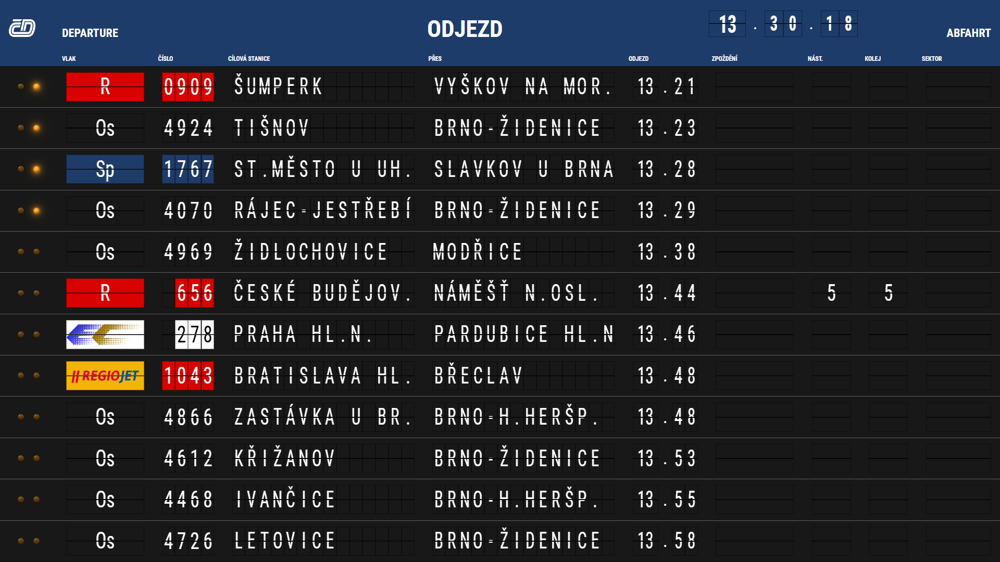
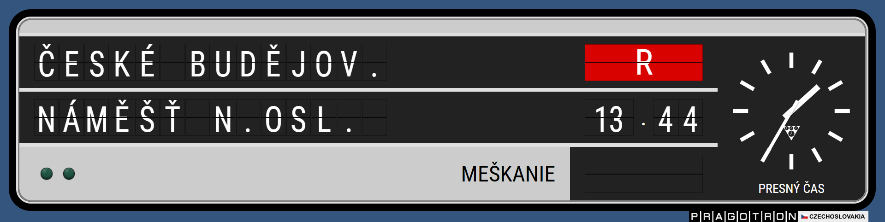

# PRAGOTRON

Framework pro retro split-flap tabule. Skládá se z klapek, katalogů, layoutu,
zvuku a ze správce, který připojené tabule ovládá najednou. Vzhled tabule ani
původ dat nejsou dané: ukázka v tomto repozitáři je jen jedna hotová sestava.

Tou sestavou jsou odjezdy vlaků. Správce je sbírá, odjezdová tabule je řadí
podle času a nástupištní tabule ukazují nejbližší odjezd své koleje. Výchozí
stanice je Brno hlavní nádraží a výchozí zdroj je tabule Správy železnic.
Stejný správce ale umí řídit i tabuli, která vypadá jinak, a živý zdroj nemusí
být železnice. Scraper si vstup přečte po svém a správci předá seznam odjezdů.
Může za ním být modelové kolejiště, odlety z místního letiště, nebo cokoliv
jiného, co dává smysl poskládat na klapky.





Odjezdová tabule v chodu. Kliknutím se video spustí na YouTube:

[](https://www.youtube.com/watch?v=E9L6u2Y4CKs)

Veřejné API je `src/platform/index.js`. Návod na komponenty, šablony a vlastní
registr je v [docs/framework-usage.md](docs/framework-usage.md), tokeny a
pravidla vzhledu v [docs/design-system.md](docs/design-system.md).

## Vlastní tabule, jeden správce

Ukázkové stránky jsou tři a sdílejí jeden kanál:

- `platformTableManage.html` je správce. Drží odjezdy, profil stanice, živý
  zdroj, noční režim a nastavení každé připojené tabule.
- `departureBoard.html` je odjezdová tabule. Počet řádků je 1–24, výchozí 12.
- `platformTable.html` je nástupištní tabule. Identita je nástupiště, kolej
  a volitelný sektor.

Nová tabule je obyčejná HTML stránka. Každému místu na klapku dá
`data-board-slot`, v šabloně řekne, která komponenta ho kreslí a odkud ve
stavu bere hodnotu, a připojí se stejným `BoardTransport` jako ukázka. CSS
smí být celé její. Když má fyzický kotouč jiné znaky, předá vlastní sekvenci.
Když potřebuje chování, které v registru není, zaregistruje vlastní typ.

Správce potom neposílá hotový obrázek tabule, ale stav. Dvě tabule mohou
stejný odjezd složit jinak: jedna jako řadu odjezdů v hale, druhá jako jeden
velký řádek u koleje, třetí jako letištní bránu, která z polí „stanice“,
„typ“ a „čas“ udělá cíl, linku a odlet. Počet připojených tabulí není omezený
a mohou běžet i na jiném počítači ve stejné síti. Ke správci se smí připojit
jen jedna jeho stránka. Další otevření správce tabule neovládá a nabídne
odkaz, jak tabuli otevřít.

Výchozí profil stanice ukázky je `stanice/brno-hlavni-nadrazi.json`. Profil
určuje nástupiště, koleje, sektory, typy a barvy čísel. Jiná stanice, jiné
nádraží modelu nebo jiné „brány“ jsou další JSON stejného tvaru.

## Vlastní zdroj dat

Správce nezná HTML Správy železnic. Zná adresu scraperu. Vestavěný scraper
v `scripts/live-departures-server.mjs` je jeden takový zdroj: stáhne tabuli
[Správy železnic](https://provoz.spravazeleznic.cz) a přeloží ji na odjezdy.
Prohlížeč na tu stránku kvůli CORS nesahá.

Jiný zdroj je jiná adresa ve správci. Ten si z ní nejdřív vezme popis:

- `GET {adresa}/schema` vrátí název, popis a pole, která se mají ve správci
  ukázat. Pole smí být `text`, `url`, `number` nebo `select`. Jejich `id`
  pak správce posílá jako query parametry. `interval` je rezervovaný.
- `GET {adresa}` vrátí `{ "departures": [ ... ] }`. To je jediný tvar, který
  správce čeká. Co je před ním, je věc scraperu: web, sériová linka modelu,
  letištní API, soubor, cokoliv.
- `POST {adresa}/watch` a `POST {adresa}/stop` jsou volitelné. Když je schéma
  uvede, zdroj může v klidu nic nestahovat a pracovat jen po dobu, kdy správce
  sledování zapne.

Odjezd, který má skončit na ukázkových tabulích, nese čas, dvě stanice
(cíl a „přes“), typ, číslo, dopravce, zpoždění a volitelně nástupiště, kolej
a sektor. Scraper letiště do stejných polí položí cíl, mezipřistání, linku a
bránu. Scraper kolejiště tam položí to, co model právě hlásí. Správce obojí
rozešle tabulím jako jeden seznam a ruční úprava ve formuláři funguje stejně.

## Požadavky

- Node.js 20 nebo novější
- prohlížeč s ES moduly

## Spuštění

```text
npm install
npm run serve
```

Server vypíše adresu. Na tom stejném počítači otevřete správce takto, ne přes
`localhost`:

```text
http://127.0.0.1:4787/platformTableManage.html
```

`localhost` a `127.0.0.1` jsou pro prohlížeč různé originy. Na Windows navíc
`localhost` otevírá IPv6 a umí vyčerpat síťové buffery. Stránky správce,
odjezdové a nástupištní tabule se z `localhost` samy přesměrují na
`127.0.0.1`.

Výchozí port je 4787. Když je obsazený, server zkusí 5174, 3847 a 18787.
Vlastní port a jen místní režim:

```text
PORT=5174 npm run serve
HOST=127.0.0.1 npm run serve
```

Bez `HOST` server poslouchá na všech rozhraních a do konzole vypíše adresu
`Síť:` pro ostatní počítače. Port je otevřený přenos bez přihlášení. Na
internet ho nedávejte.

Odjezdová tabule:

```text
http://127.0.0.1:4787/departureBoard.html
```

Nástupištní tabule pro první nástupiště, kolej 6a, sektor A:

```text
http://127.0.0.1:4787/platformTable.html?platform=1&track=6a&sector=A
```

Ve správci zapněte **Spustit live odjezdy**. Výchozí zdroj je Brno hlavní
nádraží (`StationTable.aspx?Key=455`). Interval stahování je 30–300 sekund,
výchozí minuta.

### Parametry adresy tabule

| Parametr | Stránka | Význam |
| --- | --- | --- |
| `platform`, `track`, `sector` | nástupištní | identita tabule; bez sektoru je to celá kolej |
| `rows` | odjezdová | počet řádků 1–24, platí při načtení stránky |
| `volume` | obě | hlasitost flapů 0–100, chybějící hodnota je 100 |
| `lenses` | obě | barva čoček: `green`, `yellow`, `red`, `blue`, `coolWhite`; dvě barvy čárkou, například `red,yellow` |

Hodnoty z adresy platí po načtení. Logo, noční režim, posun zpoždění a profil
stanice posílá správce po připojení.

### Otevření bez serveru

Soubor otevřený přes `file://` použije záložní balíček (`*.file.js`). Živé
odjezdy a propojení s jiným počítačem v tom režimu nejsou. Dva taby stejného
původu se domluví i bez serveru, ale pro běžnou práci je `npm run serve`.

## Adresář

```text
departureBoard.html          odjezdová tabule
platformTable.html           nástupištní tabule
platformTableManage.html     správce
analogClock.html             samostatné hodiny
src/platform/                framework a veřejné API (index.js)
src/demos/                   ukázkový správce, tabule a záložní balíčky
src/styles/                  CSS ukázky a společné tokeny
src/templates/               ukázková šablona nástupištní tabule
stanice/                     výchozí profily stanic
scripts/                     server, kanál tabulí a kontrolní skripty
docs/                        návod a design systém
images/                      loga, značky vlaků a náhledy
sounds/                      zvuk flapu
fonts/                       Roboto Condensed
```

## Kontroly

Síť ani prohlížeč nepotřebují:

```text
node scripts/check-station-profile.mjs
node scripts/check-station-names.mjs
node scripts/check-train-types.mjs
node scripts/check-departure-date.mjs
node scripts/check-board-channel.mjs
node scripts/check-audio-stretch.mjs
```

## Cizí díla

- Písmo Roboto Condensed je pod Apache License 2.0, text licence je ve
  `fonts/RobotoCondensed-LICENSE.txt`.
- Výpočet východu a západu slunce používá balíček `sunrise-sunset-js`.
- Značky dopravců a typů vlaků patří jejich vlastníkům a jsou tu jen proto,
  aby ukázka vypadala jako skutečná tabule.

Samotný kód tohoto repozitáře zatím nemá zvolenou licenci. Dokud v kořeni
nepřibude soubor `LICENSE`, platí pro něj výchozí ochrana autorského práva.
